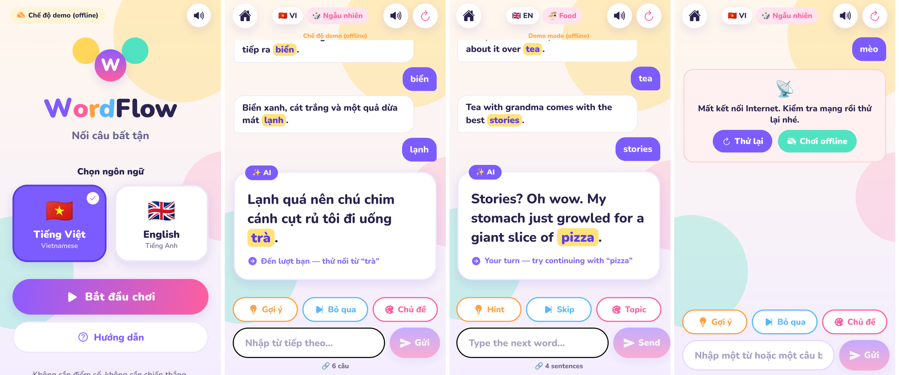

# WordFlow – Nối câu bất tận (Infinite Word Chain)



> Không cần giỏi ngôn ngữ, không cần chiến thắng, không cần điểm số.
> Chỉ cần một từ để bắt đầu và trí tưởng tượng để tiếp tục!

Game mobile casual nối câu, hỗ trợ **Tiếng Việt** và **English**, chạy trên **Android & iOS** (React Native + Expo SDK 58).

## ✅ Chạy hoàn toàn OFFLINE

**Không cần server, không cần API key, không cần Internet khi chơi.**
Bộ máy sinh câu được tích hợp sẵn trong app (`app/shared/src/demo/`):

- ~240 từ khoá tiếng Việt và ~245 từ khoá tiếng Anh, hơn 500 câu viết tay vui nhộn. Câu nào cũng kết thúc bằng một từ có câu tiếp theo, nên **chuỗi không bao giờ bị đứt** (đã kiểm tra tự động: 0 ngõ cụt).
- Từ người chơi gõ mà kho chưa có → AI offline vẫn tạo câu theo kiểu hội thoại (“Mưa à? Chú mèo nhà tôi nghe xong liền…”) theo đúng chủ đề đang chọn, rồi dẫn về một từ có trong kho.
- Hiểu từ ghép tiếng Việt (“cà phê”, “học sinh”, “khủng long”…), số nhiều / dạng từ tiếng Anh (*cookies → cookie*, *drawing → draw*).
- Ưu tiên câu dẫn tới từ có nhiều câu tiếp theo; ghi nhớ 50 câu gần nhất trong ván để tránh lặp.
- 10 chủ đề, gợi ý từ, bỏ qua, AI mở màn — tất cả chạy trên máy.

Thư mục `server/` là **tuỳ chọn** cho sau này (nếu muốn nối AI thật như ChatGPT/Claude/Gemini). Không dùng thì bỏ qua hoàn toàn.

---

## 1. Chơi thử trên điện thoại (nhanh nhất, ~10 phút)

Cần: máy tính có **Node.js 20+** ([nodejs.org](https://nodejs.org)), điện thoại cài app **Expo Go**, hai máy cùng mạng Wi‑Fi (chỉ để chép app sang điện thoại — chơi thì không cần mạng).

```bash
cd wordflow/app
npm install
npx expo start
```
Quét mã QR: Android bằng app Expo Go, iPhone bằng Camera. Xong!

> Nếu Expo Go báo không hỗ trợ phiên bản SDK, dùng cách 2 bên dưới để tạo file cài đặt thật.

---

## 2. Tạo file cài đặt APK cho Android (không cần Android Studio)

Dùng dịch vụ build đám mây miễn phí của Expo (EAS). Chỉ cần một tài khoản Expo miễn phí tại [expo.dev/signup](https://expo.dev/signup).

```bash
cd wordflow/app
npm install
npx eas-cli@latest login          # đăng nhập tài khoản Expo
npx eas-cli@latest init           # tạo project (chỉ lần đầu)
npm run build:apk                 # build APK trên đám mây (~10–20 phút)
```
Khi xong, terminal hiện **link tải + mã QR**. Mở link trên điện thoại Android → tải `.apk` → cho phép “Cài ứng dụng từ nguồn không xác định” → cài. App chạy offline 100%.

**Phát hành Google Play:** `npm run build:android` (tạo `.aab`), rồi `npx eas-cli@latest submit -p android`.

**Build trên máy của bạn (không dùng đám mây):** cài Android Studio + JDK 17, rồi
```bash
npx expo prebuild -p android
cd android && ./gradlew assembleRelease     # APK ở android/app/build/outputs/apk/release/
```

## 3. iOS (iPhone / iPad)

- Cài lên iPhone yêu cầu **tài khoản Apple Developer** (99 USD/năm) — đây là quy định của Apple.
- Có tài khoản rồi: `npm run build:ios` → `npx eas-cli@latest submit -p ios` (TestFlight / App Store). Không cần máy Mac khi dùng EAS.
- Chưa có tài khoản: chơi thử qua **Expo Go** (mục 1) hoặc bản web (`npx expo start --web`).

Trước khi phát hành, đổi bundle ID mặc định `com.wordflow.game` trong `app/app.json` thành tên của bạn.

---

## 4. Kiến trúc

```
wordflow/
├── app/shared/            LÕI GAME (TypeScript thuần, nằm trong app/ để EAS Build tải lên đủ)
│   ├── src/language.ts       Xử lý VI/EN: tiếng, từ ghép, dấu thanh, trợ từ, stemming
│   ├── src/chain.ts          Luật: câu hợp lệ, chống lặp, lọc từ không phù hợp, chuẩn hoá kết quả
│   ├── src/game.ts           State machine ván chơi
│   ├── src/demo/             ★ AI OFFLINE: demoEngine.ts + kho câu data.vi*.ts / data.en*.ts
│   └── test/
├── app/                    ỨNG DỤNG MOBILE (Expo Router)
│   ├── src/app/              Màn hình: index (Home) · game · guide
│   ├── src/components/       Giao diện
│   ├── src/game/useWordChain.ts
│   ├── src/services/ai/      AIService ← DemoAIService (offline, mặc định) | RemoteAIService (tuỳ chọn)
│   └── src/i18n/strings.ts   Chữ giao diện VI / EN
└── server/                 (TUỲ CHỌN) proxy tới AI thật, giữ API key ngoài app
```

Kết quả mỗi lượt có dạng:
```json
{ "sentence": "Cà phê giúp tôi tỉnh táo mỗi buổi sáng.", "keyword": "phê", "next_word": "sáng",
  "hint_words": ["sáng", "sáng tạo", "phở", "trà"] }
```

### Thêm câu vào kho offline
Mở `app/shared/src/demo/data.vi.extra.ts` (hoặc `data.en.extra.ts`) và thêm:
```ts
'mèo': ['Mèo nhà tôi thích ngủ trên bàn phím máy tính.'],
```
Quy tắc: câu **bắt đầu** bằng từ khoá, **kết thúc** bằng một từ cũng có trong kho, 5–15 từ, vui và lành mạnh. Chạy `cd server && npm test` — test sẽ báo nếu câu không nối được hoặc tạo ngõ cụt.

---

## 5. (Tuỳ chọn, sau này) Nối AI thật
1. `cd server && npm install && cp .env.example .env`, điền `AI_PROVIDER` (`anthropic` | `openai`), `AI_API_KEY`, `AI_MODEL` — hỗ trợ Claude, OpenAI, Gemini, OpenRouter, Ollama (AI chạy trên máy, miễn phí).
2. `npm run dev` hoặc deploy bằng `server/Dockerfile`.
3. Trong `app/.env.production` và `app/eas.json`: `EXPO_PUBLIC_AI_MODE=remote`, `EXPO_PUBLIC_API_URL=<địa chỉ server>`.
Nếu server lỗi/mất mạng, app hiện nút **“Chơi offline”** để chơi tiếp bằng bộ máy tích hợp.

---

## 6. Kiểm thử
```bash
cd server && npm install && npm test     # 25 test: ngôn ngữ, kho offline (0 ngõ cụt), chuỗi 300 lượt × 2 ngôn ngữ, reducer, server
cd app && npm run typecheck
```

## 7. Quyền riêng tư
Không đăng nhập, không email/SĐT, không tài khoản, không bảng xếp hạng, không database, không gửi dữ liệu đi đâu (chế độ offline không dùng mạng). Chuỗi câu chỉ nằm trong bộ nhớ và bị xoá khi rời màn chơi hoặc đóng app. App không xin quyền micro/vị trí/danh bạ.
